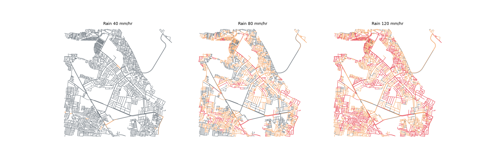
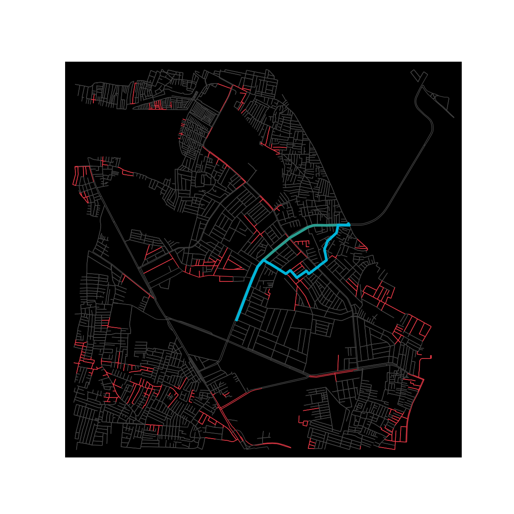
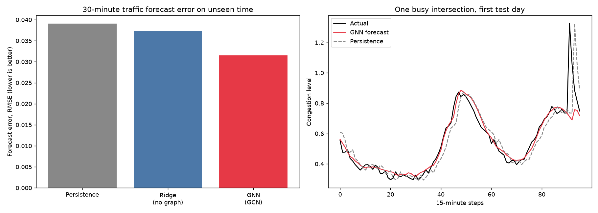
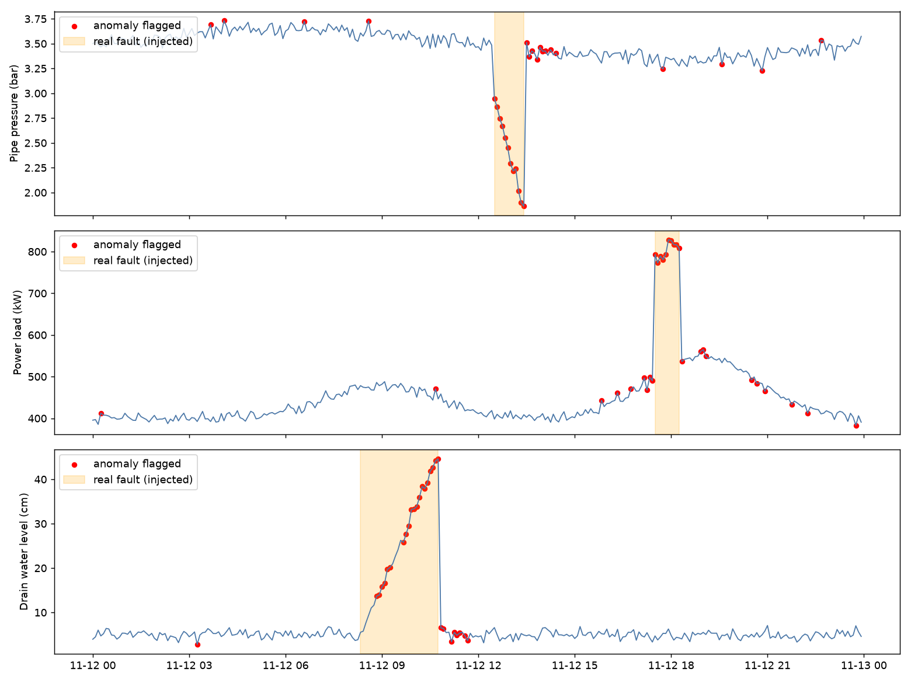

# Project NEURAL CITY

**AI-powered urban infrastructure digital twin of Koramangala, Bengaluru.**
Aarambha Hackathon, problem statement PS03 (MyStartupWave).

Roads, drainage and utilities are usually monitored separately, so nobody sees how one failure spreads into the others. NEURAL CITY models a real Bengaluru neighbourhood as one connected system: it predicts where rain will flood roads, how that slows traffic and ambulances, and lets an officer test fixes before acting.

## What it does

- **Digital twin:** 3,866 intersections and 9,851 road segments of real Koramangala (OpenStreetMap), with terrain height for every intersection.
- **Flood prediction:** water flows downhill along the road graph and collects in low spots; flood depth depends on rainfall and drainage capacity.
- **Traffic simulation:** congestion by road type and time of day; flooded roads slow down or close.
- **Emergency routing:** ambulance routes avoid flooded and closed roads (3.0 min normal vs 5.3 min in the flood scenario at 80 mm/hr, evening rush).
- **What-if simulation:** change rainfall, drainage, hour of day, close roads, or add drainage and watch everything update.
- **Resource optimization (Mayor mode):** suggests where to place pumps (4 pumps cut flooded roads from 374 to 287 at 80 mm/hr).
- **Graph neural network:** forecasts traffic 30 minutes ahead, 15.7% lower error than the best baseline.
- **IoT anomaly detection:** simulated pipe-pressure, transformer-load and drain-level sensors with automatic alerts.
- **3D visualization:** flood depth shown as 3D columns on an interactive map.

## Results

| Method (30-min traffic forecast, unseen time) | RMSE | MAE |
|---|---|---|
| Persistence (no learning) | 0.0391 | 0.0281 |
| Ridge regression (no graph) | 0.0374 | 0.0266 |
| **Graph neural network (GCN)** | **0.0315** | **0.0220** |

Flooded roads (water above 15 cm, drainage 20 mm/hr): 0 at 40 mm/hr rain, 374 at 80, 1,584 at 120.
Anomaly detection: pipe burst 12/12 readings caught, power overload 10/10, drain blockage 20/30.






## Architecture

Data (OpenStreetMap roads, terrain height, simulated rain and sensors) -> Digital twin (one connected road graph) -> AI (flood model, graph neural network, anomaly detection) -> Simulation (what-if engine) -> Decisions (ambulance routing, pump placement) -> Dashboard (interactive 3D map).

## Run it

```
git clone https://github.com/incharat2005-cpu/neural-city.git
cd neural-city
python -m venv venv
venv\Scripts\activate
pip install -r requirements.txt
streamlit run app.py
```

Map and terrain data are included (koramangala_elev.graphml). To rebuild them: run step2_map.py, then step4_elevation.py.

## Files

- flood.py: flood susceptibility and flood depth model
- traffic.py: traffic and congestion model, emergency routing
- app.py: Streamlit dashboard
- gnn_traffic.py: graph neural network forecasting vs baselines
- step8_sensors.py: simulated IoT sensors and anomaly detection
- step2_map.py, step4_elevation.py: data preparation

## Honest limitations

- Rainfall, traffic and sensor readings are **simulated**. The graph neural network is trained on simulated traffic with spillover between neighbouring roads, so its result shows the method works, not accuracy on real Bengaluru traffic.
- Terrain data is coarse (SRTM, about 90 m). Flood depth uses calibrated constants, not a full hydraulic model.
- Next steps: real traffic and sensor feeds, finer terrain (LiDAR), real drain network data, scaling to the whole city by splitting it into zones.

## HACK ELITE 

INCHARA T,
DIVYA S ,
INCHARA PATEL J P